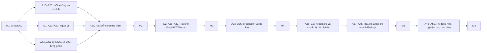
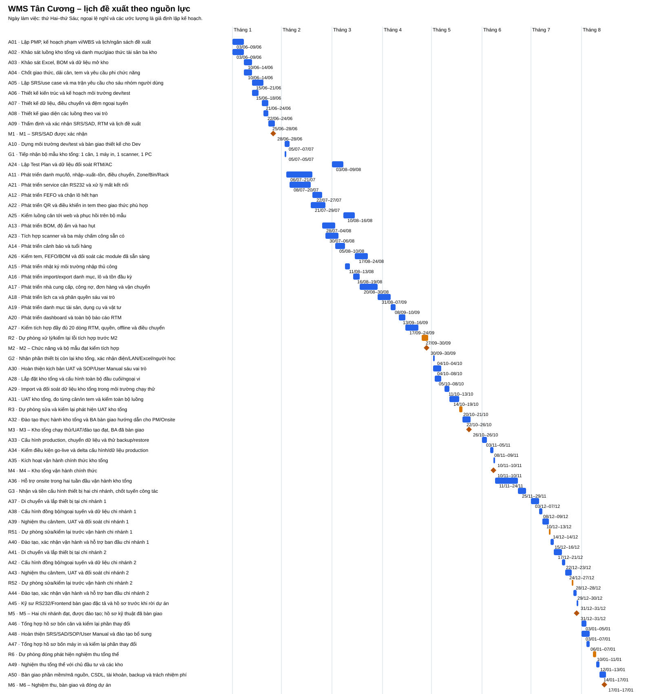

# CHƯƠNG 3. QUẢN LÝ THỜI GIAN DỰ ÁN

**Dự án:** Hệ thống Quản lý Kho Trà và Chuỗi cung ứng Tân Cương.

**Người phụ trách chương:** Nguyễn Hải Hưng — Nhóm 16.

**Phiên bản:** 1.1 — Kế hoạch tiến độ đề xuất, ngày 13/10/2026.

Chương này lập tiến độ cho dự án Hệ thống Quản lý Kho Trà và Chuỗi cung ứng Tân Cương từ tôn chỉ 01–04 và phạm vi ở chương 2. Kế hoạch bao gồm hoạt động, thời lượng, quan hệ trước–sau, phân công nguồn lực, mốc bàn giao và cách kiểm soát tiến độ. Thời gian dự án là **03/06/2027–02/02/2028**, với tám vai trò và **50 man-month (MM) — tháng công huy động** theo tài liệu 02. Các ước lượng và lịch nghỉ phục vụ tình huống bài tập lớn; người quản lý dự án xác nhận lại cùng đội trước khi phê duyệt lịch.

Bố cục gồm năm phần theo bài giảng *Quản lý thời gian dự án*, slide 5–6. Phần xác định công việc bao gồm cả sắp xếp thứ tự, tương ứng hai quy trình Define Activities và Sequence Activities trong PMBOK Guide Sixth Edition [1, 2].

| Quy trình PMBOK 6 | Nội dung áp dụng và vị trí trong chương |
| --- | --- |
| §6.1 Plan Schedule Management — lập kế hoạch quản lý lịch trình | §3.1: phương pháp, lịch làm việc, trách nhiệm và quản lý phiên bản; quy tắc báo cáo ở §3.5 |
| §6.2 Define Activities — xác định hoạt động | §3.2.1: danh mục hoạt động, thuộc tính và truy vết WBS; danh sách mốc ở §3.4.3 |
| §6.3 Sequence Activities — sắp xếp thứ tự hoạt động | §3.2.2: quan hệ phụ thuộc và sơ đồ mạng |
| §6.4 Estimate Activity Durations — ước lượng thời lượng | §3.3: ba điểm, thời lượng chọn, căn cứ và dự phòng |
| §6.5 Develop Schedule — lập lịch trình | §3.4: ngày bắt đầu/kết thúc, đường găng, Gantt, nguồn lực và dữ liệu lịch |
| §6.6 Control Schedule — kiểm soát lịch trình | §3.5: cập nhật thực tế, dự báo, báo cáo và xử lý thay đổi khi thực hiện dự án |

## 3.1. Lập kế hoạch quản lý lịch trình

### 3.1.1. Mục tiêu, đầu vào và nguyên tắc

Kế hoạch phải bảo đảm kho tổng vận hành thực tế chậm nhất cuối tháng 6; hai chi nhánh hoàn thành trong tháng 7; nghiệm thu và bàn giao toàn bộ chậm nhất cuối tháng 8. Mốc (milestone) là sự kiện có thời lượng bằng không, đánh dấu kết quả bàn giao của các hoạt động liên quan [1, slide 22; 2, §6.2.3.3].

| Đầu vào | Nội dung sử dụng |
| --- | --- |
| [01 — Mô tả đề tài](01-mo-ta-de-tai.md) | Nghiệp vụ WMS — Warehouse Management System, hệ thống quản lý kho — và các chức năng tại ba kho |
| [02 — Dự toán và nguồn lực](02-du-toan-kinh-phi.md), mục II, IV–VI | Tám vai trò, kỳ huy động, 50 MM, ba đợt thiết bị và trách nhiệm tài liệu |
| [04 — Tôn chỉ đầy đủ](04-ton-chi-du-an-day-du.md), mục 1, 3–4, 6 | Thời hạn, sản phẩm bàn giao, tiêu chí thành công và giả định vận hành |
| [Chương 2 — Quản lý phạm vi](BÁO%20CÁO%20QUẢN%20LÝ%20PHẠM%20VI%20DỰ%20ÁN.md), mục 2, 4–6 | Work Breakdown Structure (WBS) — cấu trúc phân rã công việc; 45 gói lá, từ điển, Requirement Traceability Matrix (RTM) — ma trận truy vết yêu cầu — gồm 20 dòng và sáu mốc |

PM — Project Manager, người quản lý dự án — quản lý phiên bản lịch, xác nhận đầu vào và báo cáo lệch mốc. Tech Lead thẩm định thứ tự kỹ thuật; từng vai trò xác nhận khả năng thực hiện trong kỳ huy động. Chủ đầu tư/đại diện kho xác nhận mốc bàn giao theo tôn chỉ. Thay đổi nguồn lực, phạm vi, ngân sách hoặc hạn gốc được đánh giá và phê duyệt qua quy trình thay đổi của dự án [2, §6.1, §6.6; chương 2, §6.2].

### 3.1.2. Lịch làm việc, giả định và ràng buộc

| Mã | Giả định lập kế hoạch | Ảnh hưởng và cách xác nhận |
| --- | --- | --- |
| TG-01 | Thứ Hai–thứ Sáu; 08:00–12:00 và 13:00–17:00, 8 giờ/ngày; tính lịch theo giờ làm việc thường lệ. | PM xác nhận lịch đội dự án và giờ vận hành kho trước khi duyệt đường cơ sở. |
| TG-02 | Ngày nghỉ giả định dùng trong lịch tính: 02–03/09/2027 và 24–28/01/2028, cùng các ngày cuối tuần. | PM thay các khoảng nghỉ giả định bằng lịch nghỉ được xác nhận và tính lại tiến độ trước khi phê duyệt. |
| TG-03 | Tháng dự án tính từ ngày 03 đến hết ngày 02 tháng sau. | Dùng cùng quy ước khi đọc lịch huy động: tháng 1 là 03/06–02/07; tháng 5 là 03/10–02/11; tháng 7 là 03/12–02/01. |
| TG-04 | Mỗi vai trò có một người; tổng tỷ lệ phân công mỗi ngày tối đa 100%, gồm công việc trực tiếp và quản lý xuyên kỳ. | Phân công trong kỳ của 02: BA đến hết tháng 5, kỹ sư phần cứng/Frontend đến hết tháng 7, Onsite từ tháng 5. |
| TG-05 | Một cặp Backend/Frontend phát triển lần lượt các module; giao diện và Application Programming Interface (API) — giao diện lập trình ứng dụng — được hoàn thiện trong cùng hoạt động. | Thời lượng được ước lượng cho cặp lập trình viên với tỷ lệ phân công đã ghi trong bảng hoạt động. |
| TG-06 | Bộ mẫu 33 triệu nhận đầu tháng 2; phần kho tổng 37 triệu đầu tháng 5; bộ hai chi nhánh 60 triệu nhận và kiểm trong tháng 6. | PM phối hợp mua sắm xác nhận thời gian giao, mua theo đợt và lưu giữ thiết bị theo 02 mục V. |
| TG-07 | Doanh nghiệp cung cấp biểu mẫu/dữ liệu chuẩn, thông số tài sản sẵn có và người tham gia; vòng xác nhận ban đầu hai ngày, vòng nghiệm thu cuối hai ngày. | PM theo dõi tính sẵn sàng của dữ liệu và người duyệt trước mỗi điểm kiểm soát (gate). |
| TG-08 | Khảo sát tháng 1 tại kho tổng; chi nhánh cung cấp thông tin từ xa. Đi lại triển khai mỗi chi nhánh tối đa một ngày. | Địa điểm hai chi nhánh còn cần xác nhận; PM kiểm tuyến công tác và mức dự toán 35 triệu tại 02 trước triển khai. |
| TG-09 | Kho giao dịch theo lịch TG-01 trong giai đoạn hỗ trợ; hỗ trợ sát sau vận hành (hypercare) gồm 10 ngày làm việc trong hai tuần lịch liên tiếp. | Nhu cầu trực cuối tuần/ngoài giờ, nếu có, cần lịch ca và đánh giá nguồn lực/chi phí riêng. |

Theo lịch giả định có **168 ngày làm việc** trong toàn kỳ. Thời lượng hoạt động dùng ngày làm việc; mốc và hạn dùng ngày lịch. Nếu hạn rơi vào cuối tuần, công việc phải hoàn thành vào ngày làm việc trước đó. Các giả định và ràng buộc trên là đầu vào để thẩm định ước lượng và lịch [1, slide 10; 2, §6.4.1.2, §6.4.3.2, §6.5.3.4].

### 3.1.3. Phương pháp, công cụ và quản lý phiên bản

Sử dụng phân rã từ WBS; ước lượng ba điểm có trọng số Program Evaluation and Review Technique (PERT) — kỹ thuật đánh giá và xem xét chương trình; lập mạng quan hệ và tính Critical Path Method (CPM) — phương pháp đường găng; sau đó kiểm năng lực theo ngày. Công việc quản lý xuyên kỳ dùng Level of Effort (LoE) — nỗ lực duy trì theo thời đoạn — và được phân bổ riêng trong bảng nguồn lực [1, slide 7, 13, 17–19; 2, §6.2–6.5].

Đầu vào lịch được lưu trong [du-lieu-lich.json](chuong-3/du-lieu-lich.json). Chương trình [lap-lich.py](chuong-3/lap-lich.py) tính mạng và tải nguồn lực, tạo các bảng, Gantt và XML. ProjectLibre Desktop dùng [lich-wms.pod](chuong-3/lich-wms.pod) để xem và điều chỉnh lịch theo quan hệ phụ thuộc. Vai trò các tệp và cách sử dụng được trình bày trong [README hồ sơ lịch](chuong-3/README.md).

Lịch hiện tại là **phương án đề xuất**. Sau khi chủ đầu tư phê duyệt, PM lưu phiên bản lịch và biên bản làm Schedule Baseline — đường cơ sở tiến độ. Bản cập nhật thực tế được lưu riêng để so sánh với đường cơ sở [2, §6.5.3.1].

## 3.2. Xác định hoạt động và sắp xếp thứ tự

### 3.2.1. Từ gói WBS đến hoạt động lịch

Giữ nguyên 45 mã gói lá của chương 2. Một gói có thể được chia nhiều hoạt động: gói `1.4.1.2` gồm chuẩn bị hướng dẫn và User Acceptance Testing (UAT) — kiểm thử nghiệm thu người dùng (A30), thực hiện UAT (A31), dự phòng xử lý (R3), đào tạo và bàn giao hướng dẫn (A32). Một hoạt động tích hợp có thể phục vụ nhiều gói; thời lượng được tính một lần, còn đầu ra của từng gói được truy vết qua RTM và tiêu chí nghiệm thu [2, §6.2.2.2, §6.2.3.1–2].

Bảng đầy đủ có **64 hoạt động/mốc** gồm việc thực hiện, ba điểm giao diện mua sắm, các khối dự phòng và sáu mốc; thêm sáu phân bổ LoE cho năm gói quản lý xuyên kỳ. [Bảng truy vết WBS](chuong-3/truy-vet-wbs.md) liệt kê từng gói và hoạt động tương ứng.

| Nhóm | Hoạt động chính | Kết quả |
| --- | --- | --- |
| Kế hoạch, yêu cầu và thiết kế | A01–A09 | Kế hoạch đề xuất, SRS — Software Requirements Specification, đặc tả yêu cầu; SAD — Software Architecture Document, tài liệu kiến trúc; RTM; thông số cân/tem/offline |
| Phát triển và kiểm tích hợp | A10–A27, G1, R2 | Core WMS, toàn bộ module RTM, service RS232/in tem/scanner/chấm công; bộ mẫu và hồ sơ kiểm đạt |
| Kho tổng | G2, A28–A36, R3 | Lắp đặt, dữ liệu đối soát, UAT, hướng dẫn, đào tạo, vận hành chính thức và hỗ trợ hai tuần |
| Hai chi nhánh | G3, A37–A45, R51–R52 | Lắp lần lượt từng kho, đồng bộ/ngoại tuyến, nghiệm thu thiết bị, đào tạo trước sử dụng, bàn giao hồ sơ HW/Frontend |
| Nghiệm thu và đóng dự án | A46–A50, R6 | Tổng hợp tiêu chí cân/in tem, tài liệu cuối, đào tạo bổ sung, ký nghiệm thu, bàn giao vận hành |
| Quản lý xuyên kỳ | L01–L06 | Giao ban, kiểm chi phí/dự phòng, báo cáo, đánh giá thay đổi và đảm bảo quy trình |

Nhật ký môi trường ở A15 thực hiện **nhập số đo thủ công** từ thiết bị doanh nghiệp cung cấp. Module Bill of Materials (BOM) — định mức nguyên liệu — ở A13 dùng định mức, độ ẩm và hao hụt đã xác nhận. FEFO — First Expired, First Out, ưu tiên xuất lô hết hạn trước — được lập trình và kiểm tại A12/A26. A17–A20 bao gồm tài chính, vận chuyển, lịch ca/quyền, tài sản và báo cáo theo RTM [01; chương 2, RTM].

### 3.2.2. Quan hệ phụ thuộc

Mạng dùng Precedence Diagramming Method (PDM) — phương pháp sơ đồ quan hệ trước–sau. Quan hệ chính là Finish-to-Start (FS) — công việc trước kết thúc rồi việc sau bắt đầu. A10→A11 dùng **Start-to-Start (SS) + 1 ngày làm việc**: kho mã nguồn/API khung sẵn sàng sau ngày đầu dựng môi trường, lập trình viên bắt đầu core trong khi hoàn thiện môi trường phát triển/kiểm thử. Nghiệm thu và đào tạo tuân theo thứ tự hoàn thành đầu vào ở bảng dưới [2, §6.3.2.1–3].

| Quan hệ | Loại và căn cứ |
| --- | --- |
| A02→A03/A04; A03/A04→A05 | FS, cần dữ liệu khảo sát/giao thức để chốt SRS |
| A04→A06→A07; A05→A08 | FS, kiến trúc/dữ liệu và giao diện người dùng (UI — User Interface) theo yêu cầu đã xác định; hai nhánh có thể chạy song song khi năng lực cho phép |
| M1→A10; A10→A11 SS+1d | M1 trước phát triển; chồng một phần dựng môi trường với lập trình có đầu ra trung gian rõ và phân công 20%+80% mỗi lập trình viên |
| A11→A12→…→A20 | FS theo lựa chọn tổ chức: một cặp lập trình viên hoàn thiện tuần tự để điều phối nguồn lực giữa các module |
| A21/A11/A24→A25; A22/A13/A25→A26 | FS, phải có thiết bị/chức năng/kịch bản trước kiểm thử; QA chỉ bắt đầu từ tháng 3 |
| A20/A23/A26→A27→R2→M2 | FS, kiểm RTM đầy đủ và xử lý/kiểm lại lỗi trước mốc tích hợp |
| G2→A28→A29; A29/A30→A31→R3→A32→M3 | FS, lắp/nạp dữ liệu và chuẩn bị kịch bản trước UAT; đào tạo và BA bàn giao trước cuối tháng 5 |
| M3→A33→A34→A35→M4→A36 | FS, production/khôi phục/dữ liệu/ngoại vi/người dùng đạt trước mở kho; hỗ trợ nối ngay sau go-live |
| G3→A37→A38→A39→R51→A40→A41→A42→A43→R52→A44→A45→M5 | FS, một Onsite triển khai hai kho lần lượt; từng kho kiểm/đào tạo trước vận hành; HW/Frontend bàn giao trước rời dự án |
| M5→A46→A47; M5→A48; A47/A48→R6→A49→A50→M6 | FS, tổng hợp hồ sơ, tài liệu và khắc phục trước ký nghiệm thu/bàn giao cuối |

Các ngày được phép bắt đầu (release date) gắn với kỳ huy động hoặc đợt triển khai: phát triển từ tháng 2; QA từ tháng 3; kho tổng từ tháng 5; vận hành chính thức từ tháng 6; chi nhánh từ tháng 7; nghiệm thu tổng thể từ tháng 8. G1–G3 là ngày tiếp nhận thiết bị dự kiến; kế hoạch mua sắm cần xác định ngày đặt hàng và thời gian giao phù hợp [02, mục V].

Sơ đồ tổng hợp luồng bàn giao. Quan hệ chi tiết và các nhánh song song nằm trong bảng hoạt động.

## 3.3. Ước lượng thời gian thực hiện

### 3.3.1. Lựa chọn phương pháp và cơ sở ba điểm

Với việc khảo sát, thiết kế, phát triển và tích hợp có bất định, chọn **Program Evaluation and Review Technique (PERT)** — kỹ thuật đánh giá và rà soát chương trình — theo công thức slide 13:

$$
t_E=\frac{MO+4ML+MP}{6},\qquad d=\lceil t_E\rceil.
$$

Trong đó **MO — Most Optimistic**: thời lượng lạc quan; **ML — Most Likely**: có khả năng xảy ra nhất; **MP — Most Pessimistic**: bi quan; đơn vị đều là ngày làm việc với cùng phạm vi và tỷ lệ phân công. Lịch sử dụng độ phân giải một ngày làm việc và làm tròn lên ngày nguyên.

31 hoạt động có ba điểm được làm tròn lên, tổng chênh lệch giữa ngày dùng và PERT khoảng **10,33 ngày-hoạt động**, gồm cả các nhánh song song. Ảnh hưởng tới ngày kết thúc dự án được tính theo mạng phụ thuộc; dự phòng được quản lý riêng tại các khối R trong §3.3.2.

Các ba điểm trong bảng là **ước lượng giả định của tình huống BTL**, dựa trên độ rộng nhóm chức năng và số vòng công việc. MO giả định đầu vào đúng và ít lỗi; ML gồm thực hiện và kiểm nội bộ thông thường; MP gồm một vòng sửa/xác minh dài hơn. Thay đổi lớn phạm vi hoặc thiếu thiết bị kéo dài được xử lý như rủi ro riêng. Độ tin cậy còn cần dữ liệu lịch sử hoặc expert judgment — phán đoán chuyên gia. Người thực hiện thẩm định từng ước lượng sau khảo sát, rồi cập nhật căn cứ và khoảng MO–MP trước khi duyệt lịch; hồ sơ hiện chưa xác lập mức tin cậy thống kê [1, slide 10, 13, 16; 2, §6.4.3.2].

Chương này chọn PERT có trọng số theo bài giảng, slide 13. PMBOK 6 §6.4.2.4, trang in 201 trình bày lựa chọn phân bố tam giác với trung bình `(MO + ML + MP)/3`; mỗi lựa chọn sử dụng giả định phân bố tương ứng [1, slide 13; 2, §6.4.2.4].

| Hoạt động | MO | ML | MP | PERT | Ngày đưa vào lịch | Căn cứ phạm vi |
| --- | ---: | ---: | ---: | ---: | ---: | --- |
| A02 — khảo sát kho và tài sản | 3 | 4 | 9 | 4,67 | 5 | Khảo sát kho tổng, thu đặc tả chi nhánh từ xa và một vòng làm rõ |
| A05 — SRS sáu vai trò | 3 | 4 | 9 | 4,67 | 5 | Đặc tả từ khảo sát; thẩm định/ký xác nhận tách tại A09 |
| A11 — core kho | 10 | 11 | 16 | 11,67 | 12 | Cặp Dev 80% mỗi người: danh mục/lô, kho/vị trí, giao dịch và điều chuyển |
| A13 — BOM/hao hụt | 4 | 5 | 10 | 5,67 | 6 | Quy đổi đã chốt trong SRS, trường hợp độ ẩm/hao hụt và xử lý lỗi thông thường |
| A21 — service RS232 | 7 | 8 | 13 | 8,67 | 9 | Bộ mẫu, dải cân/giao thức đã chốt, nhận/truyền và khôi phục kết nối |
| A27 — kiểm toàn RTM | 4 | 5 | 10 | 5,67 | 6 | QA 80%, hỗ trợ Dev/Lead; kiểm 20 dòng RTM sau khi mọi module sẵn sàng |
| A28 — lắp kho tổng | 2 | 3 | 8 | 3,67 | 4 | Hai PC/hai cân/hai máy in/bốn scanner và đầu cuối sẵn có; HW/Onsite đúng kỳ |
| A31 — UAT kho tổng | 2 | 3 | 8 | 3,67 | 4 | Kiểm luồng theo vai trò và từng thiết bị; sửa/kiểm lại bổ sung ở R3 |

Ba điểm và căn cứ từng dòng nằm trong [bảng đầy đủ](chuong-3/bang-hoat-dong.md). Bottom-up estimation — ước lượng từ dưới lên — được dùng để tổng hợp các hoạt động đã phân rã theo mạng phụ thuộc. Khi có dự án mẫu hoặc mô hình năng suất, nhóm có thể đối chiếu thêm bằng analogous estimation — ước lượng tương tự — hoặc parametric estimation — ước lượng tham số [2, §6.4.2.2–5].

### 3.3.2. Nỗ lực, công việc theo thời đoạn và dự phòng

Ví dụ A11 có thời lượng **12 ngày làm việc**; mỗi lập trình viên phân công 80%, nên nỗ lực dự kiến mỗi người là `12 × 8 × 0,8 = 76,8 giờ`. Tổng hai người là **153,6 giờ công**, tương đương 19,2 ngày công. Phần Tech Lead/BA hỗ trợ tính riêng trong bảng nguồn lực.

Đào tạo, nhận hàng, di chuyển, họp nghiệm thu, bàn giao và hỗ trợ tại kho dùng thời lượng trực tiếp có giả định về số buổi, vòng phản hồi và tuyến đi. A36 dành đủ 10 ngày làm việc trong hai tuần lịch ngay sau vận hành chính thức (go-live). Công việc xuyên kỳ L01–L06 dùng phần năng lực mỗi ngày từ đầu kỳ huy động đến mốc đóng M6 hoặc hết kỳ nếu sớm hơn; PM dành tổng 25%, Tech Lead 10%, QA 10% cho các việc quản lý tương ứng.

| Khối dự phòng đã đưa vào lịch | Ngày làm việc | Rủi ro được dành chỗ |
| --- | ---: | --- |
| R2 — trước M2 | 4 | Lỗi tương tác giữa module và bộ ngoại vi; sửa và kiểm lại |
| R3 — trước đào tạo kho tổng | 2 | Dữ liệu/cấu hình hiện trường khác bộ mẫu |
| R51, R52 — trước vận hành từng chi nhánh | 1 + 1 | Lỗi cấu hình/đối soát tại từng kho, giữ điều kiện đạt trước sử dụng |
| R6 — trước nghiệm thu cuối | 2 | Đóng phát hiện kiểm delta và cập nhật hồ sơ |
| **Tổng thời lượng khối dự phòng** | **10** | Sử dụng theo rủi ro và điểm kiểm soát của từng giai đoạn |

Slide 15 minh họa dự phòng theo tỷ lệ; phương án này dành khối riêng cho các rủi ro có vị trí trong mạng theo reserve analysis — phân tích dự phòng — của PMBOK. R2 xấp xỉ 7% chuỗi dựng môi trường/phát triển 54 ngày. MP phản ánh bất định thông thường trong từng hoạt động; khối R dành cho xử lý và kiểm lại tại điểm kiểm soát giữa các hoạt động hoặc tại hiện trường. Khi thẩm định, người thực hiện cần phân biệt hai phần để tránh tính trùng một vòng sửa [1, slide 15; 2, §6.4.2.6].

Dự phòng thời gian được quản lý theo từng khối R. Quỹ dự phòng chi phí **143 triệu** thuộc ngân sách hai tỷ ở 02. Khi sử dụng ngày dự phòng, PM cập nhật số ngày còn lại và phối hợp quản lý chi phí/rủi ro để đánh giá nỗ lực, kinh phí phát sinh.

## 3.4. Lập lịch trình dự án

### 3.4.1. Cách tính CPM và kiểm nguồn lực

Forward pass — lượt tính xuôi — xác định **Early Start (ES)**, bắt đầu sớm nhất, và **Early Finish (EF)**, kết thúc sớm nhất. Backward pass — lượt tính ngược — xác định **Late Start (LS)**, bắt đầu muộn nhất, và **Late Finish (LF)**, kết thúc muộn nhất. **Total Float (TF)** là độ dự trữ tổng: `TF = LS − ES = LF − EF` [2, §6.5.2.2, trang in 210].

Chỉ số ngày tính từ 0 tại 03/06/2027; mỗi hoạt động nằm trong khoảng `[ES, EF)`. Với FS không lag: `ES_sau ≥ EF_trước`; với SS+1: `ES_sau ≥ ES_trước + 1`. EF bằng ES cộng thời lượng. Release date là cận dưới bắt đầu. Khi tính ngược, ràng buộc LS của công việc sau được quy về LS của công việc trước theo đúng FS/SS; các hạn mốc là cận trên bổ sung.

CPM tính mạng logic trước giới hạn nguồn lực. Sau đó chương trình kiểm lịch theo ngày với trần phân công 100%, gồm LoE, trong kỳ huy động của từng vai trò. Khi có xung đột, chương trình dời hoạt động đến khoảng liên tục đủ năng lực, giữ thời lượng và quan hệ rồi tính lại mốc. Phương pháp phân bổ theo thứ tự hoạt động đã chọn; tính tối ưu toàn cục nằm ngoài phạm vi tính này [2, §6.5.2.3, trang in 211].

Trong phương án hiện tại, các chuỗi lập trình và Onsite đã sắp tuần tự, phần chồng A10/A11 có tỷ lệ phân công rõ. Kiểm nguồn lực giữ nguyên ngày của toàn bộ hoạt động. Kết quả phù hợp với năng lực trong mô hình; năng suất thực tế cần được đội dự án thẩm định theo §3.3.1.

### 3.4.2. Các chuỗi chi phối mốc và dự trữ

Đường găng được xác định theo điểm kết thúc tham chiếu. Bảng dưới trình các chuỗi găng **so với thời điểm sớm nhất của từng mốc**. Bảng hoạt động đầy đủ trình TF của mạng có hạn các mốc gốc và thời điểm hoàn thành sớm nhất toàn dự án; khoảng dư đến hạn gốc được tính riêng ở §3.4.3.

| Mốc tham chiếu | Chuỗi chi phối chính | Ý nghĩa |
| --- | --- | --- |
| M1 | A02→A03/A04→A05→A08→A09; nhánh A04→A06→A07→A09 cùng chi phối | Cần cả yêu cầu/UI và kiến trúc/dữ liệu trước xác nhận; ngày đề xuất 28/06 |
| M2 | A10 SS+1→A11→A12→A13→A14→A15→A16→A17→A18→A19→A20→A27→R2→M2 | Cặp Dev tuần tự rồi kiểm đầy đủ; release đầu tháng 2 chi phối bắt đầu; còn 1 ngày làm việc đến hạn |
| M3 | G2→A28→A29→A31→R3→A32→M3 | Nhận hàng/lắp/nạp dữ liệu chi phối UAT; A30 chuẩn bị tài liệu chạy song song |
| M4 | A33→A34→A35→M4 | Chuẩn bị vận hành từ tháng 6, kiểm điều kiện trước kích hoạt; go-live đề xuất 10/11 |
| M5 | A37→A38→A39→R51→A40→A41→A42→A43→R52→A44→A45→M5 | Hai chi nhánh tuần tự với một Onsite; dùng đủ 21 ngày làm việc từ 03/12–31/12 |
| M6 | Chuỗi M5→A46→A47→R6→A49→A50; nhánh M5→A48→R6 cùng chi phối | Hồ sơ thiết bị và tài liệu cuối cùng đều cần trước ký nghiệm thu; hoàn thành đề xuất 17/01 |

Ví dụ chuỗi M5: A37 có ES=129, EF=132, LS=129, LF=132; A45 có ES=149, EF=150, LS=149, LF=150; TF=0. A37 chậm một ngày làm việc làm trễ M5 nếu chưa có biện pháp khôi phục; phần bàn giao HW/Frontend sẽ vượt kỳ huy động. Tình huống A11 tăng ba ngày, giữ các đầu vào khác, cho M2 ngày **05/10**, vượt hạn **02/10** dù M4 vẫn còn khoảng dư.

### 3.4.3. Lịch tổng thể và sáu mốc

Ngày trong bảng dùng `DD/MM/YYYY`; dữ liệu JSON/CSV dùng `YYYY-MM-DD` cho cùng một ngày.

| Mốc | Sản phẩm và điều kiện chính | Hoàn thành đề xuất | Hạn gốc | Dư đến hạn, ngày làm việc |
| --- | --- | --- | --- | ---: |
| M1 | SRS/SAD, RTM, thông số cân/tem, danh mục tài sản và offline được xác nhận | 28/06/2027 | 02/07/2027 | 4 |
| M2 | Core, ngoại vi và mọi chức năng RTM đạt kiểm tích hợp; AC-01/02 trên bộ mẫu | 30/09/2027 | 02/10/2027 | 1 |
| M3 | Kho tổng lắp đủ thiết bị, đối soát dữ liệu, UAT và đào tạo đạt; BA bàn giao tài liệu | 26/10/2027 | 02/11/2027 | 5 |
| M4 | Production/dữ liệu/ngoại vi/người dùng sẵn sàng; kho tổng vận hành chính thức | 10/11/2027 | 02/12/2027 | 16 |
| M5 | Hai chi nhánh đạt nghiệm thu thiết bị/đồng bộ/đào tạo và bàn giao hồ sơ kỹ thuật | 31/12/2027 | 02/01/2028 | 0 |
| M6 | Tổng hợp AC-01–AC-04, tài liệu, ký nghiệm thu và bàn giao quản trị/phí duy trì | 17/01/2028 | 02/02/2028 | 7 |

Khoảng dư tính từ ngày hoàn thành đề xuất tới hạn gốc, **sau** các khối dự phòng đã đưa vào lịch. Hạn M2 là thứ Bảy và M5 là Chủ nhật; phương án hoàn thành trước ngày nghỉ. A36 hỗ trợ kho tổng **11–24/11/2027**, hai tuần lịch liên tiếp sau go-live; nhận và tiền cấu hình thiết bị chi nhánh diễn ra **25–29/11** trong tháng 6.

Biểu đồ được tạo từ kết quả tính bằng `lap-lich.py` và có thể mở riêng để phóng to. Màu xanh là việc thực hiện, màu cam là khối dự phòng, hình thoi là mốc. LoE được trình bày riêng trong bảng nguồn lực và tệp ProjectLibre.

### 3.4.4. Tính phù hợp với nguồn lực và ngân sách

| Vai trò | Kỳ huy động theo 02 | Ngày khả dụng | Ngày công phân công trong mô hình | Tải đỉnh |
| --- | --- | ---: | ---: | ---: |
| PM | Tháng 1–8 | 168 | 48,55 | 95% |
| Tech Lead (TL) | Tháng 1–8 | 168 | 44,90 | 90% |
| Kỹ sư RS232 (HW) | Tháng 2–7 | 128 | 33,70 | 80% |
| Business Analyst (BA) | Tháng 1–5 | 107 | 23,05 | 90% |
| Backend (BE) | Tháng 2–8 | 146 | 57,30 | 100% |
| Frontend (FE) | Tháng 2–7 | 128 | 47,60 | 100% |
| QA/QC — Quality Assurance/Quality Control, đảm bảo/kiểm soát chất lượng | Tháng 3–8 | 125 | 50,00 | 90% |
| Onsite (OS) | Tháng 5–8 | 83 | 36,20 | 90% |

Tải đỉnh 100% của Dev xuất hiện trong phần chồng dựng môi trường/core; sau đó mức trực tiếp 80% dành khoảng trống cho phối hợp và công việc chưa chi tiết. Tải theo ngày nằm ở [tai-nguon-luc.csv](chuong-3/tai-nguon-luc.csv). Phân công tỷ lệ trung bình cần được chuyển thành lịch buổi/họp thực tế trước thực hiện, đặc biệt khi nhiều người cùng cần tham gia một phiên.

Ngày công trong bảng phản ánh nỗ lực của các hoạt động đã liệt kê. Ngân sách nhân sự tính theo toàn kỳ huy động **50 MM** ở 02. Phần năng lực chưa gán dành cho phối hợp, hỗ trợ và bất định; mức sử dụng còn thấp cần được thẩm định lại về độ chi tiết công việc và năng suất trước khi duyệt đường cơ sở. Quyết định điều chỉnh huy động hoặc thanh toán cần căn cứ riêng về nhân sự và chi phí [02, mục II, V].

BA hoàn thành và bàn giao Standard Operating Procedure (SOP) — quy trình thao tác chuẩn — và User Manual — hướng dẫn người dùng — tại A32 ngày 26/10, trong tháng 5. Onsite/PM dùng bộ tài liệu này để đào tạo chi nhánh. HW/Frontend bàn giao tại A45 ngày 31/12, trước kết thúc tháng 7; QA/Tech Lead và PM xác nhận đã nhận đặc tả, cấu hình, hồ sơ phép đo bốn cân/bốn máy in và danh sách vấn đề còn mở. Thiết bị được kiểm trước sử dụng ở từng kho; tháng 8 QA/Tech Lead tổng hợp hồ sơ và kiểm lại phần thay đổi.

LoE kết thúc cùng mốc đóng M6 ngày 17/01 trong phương án hiện tại. Đến hạn 02/02 còn bảy ngày làm việc. Lịch huy động và ngân sách lương áp dụng theo 02; điều khoản kết thúc huy động/thanh toán thực tế cần được xác nhận riêng.

### 3.4.5. Điểm yếu của phương án và biện pháp trước phê duyệt

1. **M5 có khoảng dư bằng 0** sau chuỗi và hai ngày dự phòng tại điểm kiểm soát. PM xác nhận địa điểm, tuyến đi, người học, dữ liệu và thiết bị trước tháng 7; ưu tiên tiền cấu hình trong tháng 6. Nếu cần thêm ngày, PM lập phương án khôi phục tiến độ trong kỳ huy động hoặc trình thay đổi nguồn lực/chi phí.
2. **M2 chỉ dư một ngày**. Đội dự án thẩm định tính đủ của 51 ngày phát triển module và 6 ngày kiểm đầy đủ. Có thể xét kiểm từng phần đã hoàn thành hoặc đổi quan hệ điều phối, đồng thời giữ đủ 20 dòng RTM và kiểm lại mức tải.
3. **G1/G2/G3 là ngày tiếp nhận dự kiến**. Kế hoạch mua sắm cần xác nhận ngày đặt/giao hàng, phụ kiện và giao thức tương thích của thiết bị; hoạt động nghiệm thu tại từng kho xác nhận điều kiện sử dụng.
4. **Ngày nghỉ, giờ kho và ước lượng cần được thẩm định**. Việc duyệt lịch dựa trên xác nhận TG-01–TG-09, lịch nguồn lực, căn cứ ước lượng và đầu vào khách hàng.

Hai tình huống phản ứng trong nguồn lực hiện có:

- **A37 tăng một ngày:** nếu nghiệm thu chi nhánh 1 đạt và R51 còn nguyên, PM xác nhận giải phóng **một ngày R51 chưa sử dụng**. Tính lại với `A37 + 1`, `R51 = 0` giữ M5 ngày 31/12; hai ngày nghiệm thu và hai ngày đào tạo/hỗ trợ được giữ đủ. Nếu còn lỗi cần xử lý hoặc dự phòng đã dùng, PM đánh giá phương án khôi phục khác và trình thay đổi khi vượt giới hạn.
- **A11 tăng ba ngày:** nếu kiểm tích hợp đạt và chỉ cần hai ngày R2, PM xác nhận giải phóng **hai ngày R2 chưa sử dụng**. Tính lại với `A11 + 3`, `R2 = 2` cho M2 ngày 01/10, trong hạn 02/10 và còn **0 ngày làm việc dư**. Nếu lỗi thực tế cần cả khối R2, PM đánh giá phương án khác với đủ kiểm thử, nguồn lực và chi phí.

Các phép thử áp dụng khi điều kiện nghiệm thu và dự phòng nêu trên được xác nhận. PM ghi số ngày dự phòng còn lại, người xác nhận và ảnh hưởng chi phí/nguồn lực trước quyết định.

## 3.5. Kiểm soát lịch trình

### 3.5.1. Chu kỳ cập nhật và bằng chứng tiến độ

Hằng tuần, từng vai trò gửi ngày bắt đầu/kết thúc thực tế, thời lượng còn lại, đầu ra hoàn thành và trở ngại. PM cập nhật lịch vào ngày chốt báo cáo thứ Sáu, tính lại quan hệ/ngày mốc/tải và so với bản đường cơ sở đã duyệt. Hằng tháng báo cáo chủ đầu tư theo gói `1.1.2.3`; lệch có thể làm trễ mốc không chờ báo cáo tháng mới xử lý [1, slide 26; 2, §6.6].

Công việc hoàn tất khi đầu ra đạt tiêu chí và có người xác nhận: SRS/SAD có phiên bản/phê duyệt; module có kết quả theo RTM; cân/tem có phép đo theo từng thiết bị; dữ liệu có bảng đối soát; đào tạo có danh sách/kết quả thực hành; nghiệm thu/bàn giao có biên bản. Phần trăm tiến độ trung gian được xác định từ đầu ra đã hoàn thành của gói, cùng thời lượng còn lại do người thực hiện dự báo.

| Trường cập nhật | Cách sử dụng |
| --- | --- |
| Mã hoạt động/WBS, ngày chốt báo cáo | Định danh phần việc và thời điểm dữ liệu |
| Baseline Start/Finish — ngày kế hoạch gốc | Giữ nguyên bản được duyệt để so sánh |
| Actual Start/Finish — ngày thực tế | Ghi khi đã xảy ra, có bằng chứng; chưa xảy ra để trống |
| Remaining Duration — thời lượng còn lại | Người thực hiện dự báo theo khối lượng công việc còn lại tại ngày chốt báo cáo |
| Forecast Finish — kết thúc dự báo | Tính lại từ dữ liệu hiện tại, quan hệ, lịch và nguồn lực |
| Đầu ra/tiêu chí, trở ngại, người xử lý | Dùng để xác nhận hoàn thành và quyết định hành động |
| Dự phòng đã dùng/còn lại | Theo từng khối R; xác nhận đầu ra đạt trước khi giải phóng ngày dự phòng còn dư |

### 3.5.2. Ngưỡng cảnh báo và xử lý thay đổi

Ngưỡng cảnh báo đề xuất của dự án gồm: dự báo mốc trễ hạn, hoạt động có TF âm, tải vượt 100%, phân công ngoài kỳ huy động, đầu vào điểm kiểm soát chưa sẵn sàng, hoặc khoảng dư một mốc còn **tối đa một ngày làm việc**. M2/M5 thuộc diện ưu tiên theo dõi ngay từ lúc lập kế hoạch. PMBOK §6.1.3.1 hướng dẫn xác lập ngưỡng; giá trị một ngày ở đây được chọn cho dự án.

PM và Tech Lead xác định nguyên nhân, xét tổ chức lại công việc, kiểm sớm theo đầu ra, dùng đúng khối dự phòng hoặc điều chỉnh phân công trong năng lực sẵn có. Fast tracking — làm chồng công việc — cần đầu ra trung gian rõ và đánh giá rủi ro sửa lại. Crashing — rút thời lượng bằng nguồn lực/chi phí bổ sung — cần phương án được phê duyệt. Thay đổi phạm vi, nguồn lực, ngân sách hay hạn gốc được lập thành Change Request (CR) — yêu cầu thay đổi — và đánh giá ảnh hưởng tới chương 2, 4–9 trước quyết định [2, §6.5.2.6, §6.6.3.2; chương 2, §6.2].

### 3.5.3. Chỉ số kiểm soát theo ngân sách

Earned Value Management (EVM) — quản lý giá trị thu được — liên kết công việc, tiến độ và ngân sách. Bài giảng dùng **Budgeted Cost of Work Scheduled (BCWS)**, chi phí ngân sách của công việc dự kiến; **Budgeted Cost of Work Performed (BCWP)**, chi phí ngân sách của công việc thực sự hoàn thành; **Actual Cost of Work Performed (ACWP)**, chi phí thực tế đã thực hiện [1, slide 27–28].

Các tên tương ứng thường dùng là **Planned Value (PV)** — giá trị kế hoạch; **Earned Value (EV)** — giá trị thu được; **Actual Cost (AC)** — chi phí thực tế. Khi có đường cơ sở chi phí và dữ liệu thực tế hợp lệ:

- **Schedule Variance (SV)** — chênh lệch tiến độ: `SV = EV − PV`; dương/về 0/âm biểu thị giá trị công việc vượt/đúng/chậm so với kế hoạch tại ngày chốt.
- **Schedule Performance Index (SPI)** — chỉ số hiệu suất tiến độ: `SPI = EV / PV`, chỉ tính khi `PV > 0`; lớn hơn/bằng/nhỏ hơn 1 biểu thị vượt/đúng/chậm theo giá trị ngân sách.

SV đo chênh lệch theo giá trị ngân sách. Để đánh giá ngày bàn giao, PM đọc SV/SPI cùng đường găng và ngày kết thúc dự báo (Forecast Finish); ở cuối dự án dùng ngày hoàn thành thực tế so với hạn mốc [2, §6.6.2.1; §7.4.2.2].

02 mục V phân bổ ngân sách theo tháng; ngân sách theo hoạt động/WBS và **143 triệu dự phòng** còn cần hoàn thiện. Hồ sơ hiện ở giai đoạn lập kế hoạch, chưa có EV/AC thực tế. SV/SPI được áp dụng khi chương 4 xác lập Cost Baseline — đường cơ sở chi phí — quy tắc đo EV, cách xử lý dự phòng và liên kết với lịch được duyệt. Tổng Budget at Completion (BAC) — ngân sách khi hoàn thành — là hai tỷ [02, mục V.1–V.4].

## Tài liệu tham khảo

1. Ngô Tiến Đức, *Quản lý thời gian dự án*, `5-time.pdf`, bài giảng môn Quản lý dự án phần mềm, PTIT: slide 5–6 (quy trình), 7–10 (hoạt động/căn cứ), 13–16 (PERT/dự phòng), 17–19 (CPM), 22–25 (mốc/Gantt), 26–28 (kiểm soát), 29 (bài tập). Học liệu do lớp cung cấp; số trang ở đây là số slide.
2. Project Management Institute (2017), *A Guide to the Project Management Body of Knowledge (PMBOK Guide)*, Sixth Edition: §6.1, tr.179–182; §6.2–6.3, tr.183–194; §6.4, tr.195–204; §6.5, tr.205–221; §6.6, tr.222–230; §7.4.2.2 (EVM). Các số trang là **trang in sách**, không phải số trang của trình đọc PDF. Tham khảo [đính chính chính thức PMBOK 6](https://www.pmi.org/-/media/pmi/documents/public/pdf/pmbok-standards/pmbok-guide-6th-errata.pdf) khi dùng hình/quy trình của sách.
3. Nhóm 16, bộ tài liệu dự án 01–04 và *Báo cáo quản lý phạm vi dự án*, phiên bản nguồn hiện hành ngày 13/10/2026; dẫn mục cụ thể ở từng phần trên.
4. ProjectLibre, [ProjectLibre Desktop](https://projectlibre.com/projectlibre-desktop/) và [Overview of ProjectLibre](https://projectlibre.com/projectlibre-documentation/overview/), truy cập 13/10/2026 — căn cứ chọn và mở/lưu lịch công cụ.
5. GanttProject, [trang sản phẩm chính thức](https://www.ganttproject.biz/), truy cập 13/10/2026 — phương án công cụ lập lịch/Gantt và phân bổ nguồn lực.
6. Microsoft, [Project desktop client service description](https://learn.microsoft.com/en-us/office365/servicedescriptions/project-online-service-description/project-online-desktop-client-service-description), truy cập 13/10/2026 — tham khảo công cụ có dependencies, critical path, baseline và resource leveling.

## Phụ lục. Hồ sơ lịch và khảo sát công cụ

| Thành phần | Nội dung |
| --- | --- |
| [Bảng hoạt động đầy đủ](chuong-3/bang-hoat-dong.md) | Mã/WBS, thời lượng/ba điểm, quan hệ, phân công, ngày, ES/EF/LS/LF/TF và căn cứ |
| [Truy vết WBS](chuong-3/truy-vet-wbs.md) | 45 gói lá của chương 2 tới hoạt động và LoE |
| [Dữ liệu gốc](chuong-3/du-lieu-lich.json), [kết quả](chuong-3/ket-qua-lich.json) | Lịch làm việc/ngoại lệ, nguồn lực, đầu vào và kết quả tính |
| [CSV hoạt động](chuong-3/bang-hoat-dong.csv), [CSV tải](chuong-3/tai-nguon-luc.csv) | Kết quả lịch đề xuất để xem bằng bảng tính; thay đầu vào và tính lại theo README |
| [Gantt](chuong-3/gantt.svg), [XML](chuong-3/lich-wms.xml), [ProjectLibre](chuong-3/lich-wms.pod), [README](chuong-3/README.md) | Lịch trực quan, tệp chỉnh trong công cụ, nguồn trao đổi và hướng dẫn sử dụng |

| Công cụ khảo sát | Vai trò phù hợp với BTL | Giới hạn cần cân nhắc |
| --- | --- | --- |
| ProjectLibre Desktop | Công cụ được chọn: lịch một dự án, Gantt/mạng, mốc và phân công; mở/lưu XML và định dạng `.pod` [4] | Bản Desktop trên từng máy; cần thống nhất phiên bản lịch, cách mở và chuyển đổi theo hướng dẫn. |
| GanttProject | Phương án miễn phí cho lập lịch/Gantt, phân bổ nguồn lực và trao đổi XML/MSPDI [5] | Cần thử khả năng giữ calendar/quan hệ/phân công khi đổi công cụ; chưa dùng để tính lịch hiện tại. |
| Microsoft Project Desktop | Tham khảo bộ chức năng phụ thuộc, critical path, baseline và resource leveling [6] | Cần quyền sử dụng phù hợp; không phát sinh mua giấy phép trong kế hoạch bài tập. |

Hồ sơ áp dụng phương pháp ước lượng và lập lịch vào dự án, cung cấp tệp công cụ để chỉnh lịch, đồng thời khảo sát hai phương án công cụ khác theo bài tập slide 29 [1].
